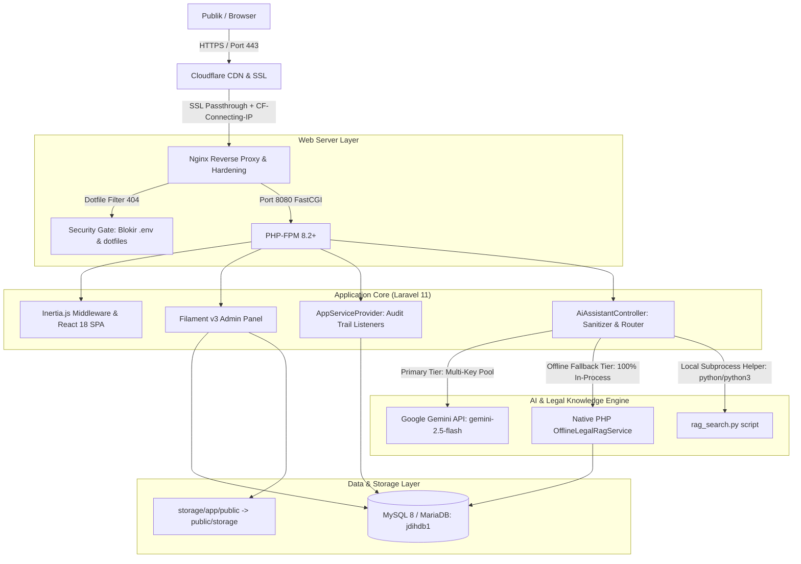

# Arsitektur Sistem — JDIH Kabupaten Banjarnegara

Dokumen ini menjelaskan arsitektur makro, aliran data, dan interaksi antarkomponen pada sistem JDIH Kabupaten Banjarnegara.

## 1. Lapisan Presentasi (Presentation Layer)
- **Frontend Publik**: React 18 dibungkus oleh Inertia.js untuk pengalaman Single Page Application (SPA) yang dinamis tanpa perlu membangun REST API terpisah untuk setiap view.
- **Styling**: Tailwind CSS dengan variasi tema modern sivik, typography Plus Jakarta Sans / Outfit, dan responsivitas laptop (1366×768 / scaling 125%) hingga ponsel (Android 3M).
- **Admin Panel**: Filament v3 yang terintegrasi secara modular dengan Form Builder, Table Builder, Notification, dan Actions.
- **Aset Frontend**: Terkompilasi mandiri via Vite (`public/build`) di lingkungan pengembang lokal sehingga server produksi dapat beroperasi tanpa Node.js.

## 2. Lapisan Logika & Bisnis (Business Logic Layer)
- **Framework**: Laravel 11 dengan struktur MVC yang bersih.
- **Audit Logging**: Event-driven menggunakan listener `Illuminate\Auth\Events\Login` dan `Logout` di `AppServiceProvider` yang merekam `user_id`, nama, email, aksi, guard, IP publik (`$http_cf_connecting_ip`), user-agent, dan waktu WIB.
- **RAG & AI Assistant**: Layanan asisten hukum multi-tier:
  1. *Primary*: Google Gemini API dengan rotasi multi-key pool (`GEMINI_API_KEYS`) dan fallback pool model.
  2. *Secondary / Offline*: `OfflineLegalRagService` 100% Native PHP in-process via Eloquent & text matching (bebas dari subprocess Python atau kegagalan koneksi luar).
  3. *Error Masking Sanitizer*: Menjamin pesan kegagalan CLI/server internal tidak bocor ke antarmuka publik.

## 3. Lapisan Database & Storage (Data Layer)
- **Database Engine**: MySQL 8 / MariaDB dengan engine InnoDB penuh dan collation `utf8mb4_unicode_ci`.
- **Media Storage**: Menggunakan disk `public` di bawah `storage/app/public/` yang terhubung via symlink ke `public/storage`.
