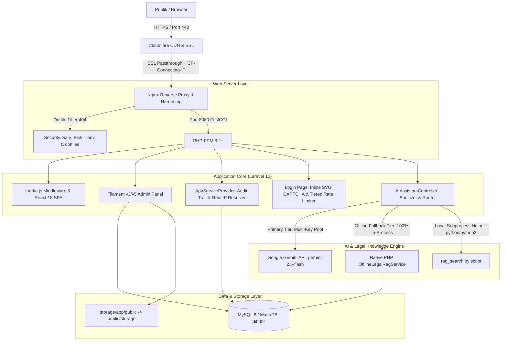

# Arsitektur Sistem — JDIH Kabupaten Banjarnegara

Dokumen ini menjelaskan arsitektur makro, aliran data, dan interaksi antarkomponen pada sistem JDIH Kabupaten Banjarnegara.

## 1. Lapisan Presentasi (Presentation Layer)
- **Frontend Publik Desktop**: React 18 dibungkus oleh Inertia.js untuk pengalaman Single Page Application (SPA) yang dinamis tanpa perlu membangun REST API terpisah untuk setiap view.
- **Frontend Mobile & PWA (`/mobile/*`)**: 
  - **Sticky Bottom Navigation (5 Tabs)**: `Home`, `Peraturan` (trigger Action Sheet), `Cari` (elevated teal button), `Berita`, dan `Menu` (trigger Action Sheet).
  - **Action Sheet Drawers (`framer-motion`)**:
    - *Drawer Peraturan*: Akses cepat ke Perda, Perbup, SK Bupati, Produk Hukum Desa (OpenSID), Putusan, dan Monografi Hukum.
    - *Drawer Menu*: Akses ke Statistik Dokumen (`/mobile/statistik`), Konsultasi & Aspirasi (`/mobile#aspirasi`), Modal Survei Kepuasan (IKM), Profil JDIH, Portal Nasional JDIHN, dan Linktree.
  - **8-Sektor Selang-Seling Beranda (`Mobile/Home.tsx`)**: Menghilangkan visual monoton dengan ritme palet dinamis: Sektor 1 Hero Navy/Teal, Sektor 2 Soft Canvas Kategori, Sektor 3 Mint Infografis, Sektor 4 Pure White Produk Hukum, Sektor 5 Midnight Slate Statistik, Sektor 6 Slate Warta JDIH, Sektor 7 Cyan Video Edukasi, dan Sektor 8 Tautan Lembaga.
  - **Halaman Khusus Mobile Terintegrasi**:
    - `Mobile/ProdukHukumDesa.tsx`: Antarmuka mobile integrasi 63 OpenSID dengan filter kecamatan, desa, kategori, pencarian, dan tombol aksi terpadu *"Lihat / Unduh"*.
    - `Mobile/InfoJdih.tsx`: Pusat profil lembaga mobile dengan accordion expandable interaktif (Visi Misi, Dasar Hukum, Tupoksi, SOP).
    - `Mobile/Statistik.tsx`: Visualisasi tren data dan volume dokumen regulasi via Recharts (kontainer `h-[340px]`, offset `bottom: 65px`, toggle filter Top 8/Semua, `minPointSize=4`) serta card statistik pengunjung.
    - `Statistik.tsx` (Desktop): Visualisasi komprehensif produk hukum ditambah card metrik pengunjung portal (Hari Ini, Bulan Ini, Total Kunjungan, Dokumen Dibaca, dan Live Online status).
  - **Progressive Web App (PWA)**: Dilengkapi Service Worker (`public/sw.js`) dan manifest standalone (`public/manifest.json`).
- **Styling**: Tailwind CSS dengan variasi tema modern sivik Teal `#0d9488`, typography Figtree, dan responsivitas laptop (1366×768 / scaling 125%) hingga ponsel (Android 3M: 360px, 393px, 412px).
- **Admin Panel**: Filament v3 yang terintegrasi secara modular dengan Form Builder, Table Builder, Notification, dan Actions.
- **Aset Frontend**: Terkompilasi mandiri via Vite (`public/build`) di lingkungan pengembang lokal sehingga server produksi dapat beroperasi tanpa Node.js.

## 2. Lapisan Logika & Bisnis (Business Logic Layer)
- **Framework**: Laravel 12 (v12.69.2) dengan struktur MVC yang bersih.
- **Admin Authentication & Tiered Rate Limiter (`app/Filament/Pages/Auth/Login.php`)**:
  - *Inline SVG CAPTCHA*: Tantangan matematika acak bergaya tema JDIH Teal (`#0d9488`) untuk memblokir bot DOM scraping dan serangan otomatis, dilengkapi tombol refresh instan.
  - *Tiered Rate Limiter (Bertahap)*:
    - **Tahap 1 (Akun/Email)**: Maksimal 5x gagal per 60 detik per email. Jika satu staf admin salah password, admin lain di jaringan LAN kantor Pemda yang sama tidak ikut terkunci.
    - **Tahap 2 (IP Bersama)**: Maksimal 25x gagal per 60 detik per IP publik untuk menangkal brute-force masif atau *credential stuffing*.
  - *Crypto Verification*: Validasi jawaban menggunakan `hash_equals` dan anti-replay cache guard (`used_captcha`).
- **Dynamic HTTPS & CSP Security Gate**:
  - `AppServiceProvider.php` secara dinamis memaksakan HTTPS pada host produksi publik, dan mengecualikan `localhost`, `127.0.0.1`, dan `*.test` agar dev server lokal bebas dari error handshake SSL (`ERR_CONNECTION_CLOSED`).
  - `SecurityHeaders.php` mengimplementasikan CSP dinamis: mengizinkan script dan WebSocket HMR dari Vite dev server (`http://127.0.0.1:5173`) pada lingkungan pengembang lokal, sementara pada environment produksi tetap menerapkan CSP ketat (strict CSP) dan HSTS enforcement.
- **Real IP Support & Proxy Resolution**:
  - Mengaktifkan `$middleware->trustProxies(at: '*')` di `bootstrap/app.php`.
  - Fungsi `AppServiceProvider::getClientIp()` memprioritaskan `CF-Connecting-IP` (Cloudflare CDN/Tunnel), `X-Real-IP`, dan `X-Forwarded-For` dengan filter sanitasi `FILTER_VALIDATE_IP`.
- **Traffic Analytics & Visitor Tracker (`RecordVisitor.php`)**: Middleware pencatatan trafik non-blocking ke tabel `visitors` yang merekam IP asli dan tanggal kunjungan harian dengan throttling cache 60 detik per IP, tracking live online user (sliding window 5 menit), serta agregasi pembacaan dokumen.
- **Audit Logging Terstruktur (`LogsActivity.php` & `ActivityLog.php`)**:
  - Event-driven listener `Login`, `Logout`, dan `Failed` di `AppServiceProvider`.
  - Pemisahan pelabelan: Kunjungan baca/unduh publik otomatis dilabeli `Pengunjung (Tamu)` dengan rincian metrik (`view_count: A → B`), sementara perubahan administratif dicatat lengkap dengan akun admin penanggung jawab (`user_name`, `user_email`, dan diff atribut). Kolom sensitif (`password`, `remember_token`) mutlak diabaikan dari pencatatan log.
- **RAG & AI Assistant**: Layanan asisten hukum multi-tier terintegrasi pada antarmuka Desktop (modal popup) dan Mobile (bottom-sheet drawer 85vh):
  1. *Primary*: Google Gemini API dengan rotasi multi-key pool (`GEMINI_API_KEYS`) dan fallback pool model.
  2. *Secondary / Offline*: `OfflineLegalRagService` 100% Native PHP in-process via Eloquent & text matching (bebas dari subprocess Python atau kegagalan koneksi luar).
  3. *Error Masking Sanitizer*: Menjamin pesan kegagalan CLI/server internal tidak bocor ke antarmuka publik.

## 3. Lapisan Database & Storage (Data Layer)
- **Database Engine**: MySQL 8 / MariaDB dengan engine InnoDB penuh dan collation `utf8mb4_unicode_ci`.
- **Media & PDF Storage**: Menggunakan disk `public` di bawah `storage/app/public/` yang terhubung via symlink ke `public/storage`.
- **Resilient File Accessor**: Model `LegalDocument` menghasilkan path relatif `/storage/...` ter-encode per segmen (`rawurlencode`), mencegah ketergantungan pada hostname absolut dan menjamin preview PDF render sempurna di dev server maupun domain produksi. Tag viewer membungkus `<iframe>` di dalam `<object>` untuk kompatibilitas peramban maksimal.

## 4. Lapisan Integrasi Desa & Inter-Server (OpenSID Integration Layer)
- **Inter-Server Loopback Resolution (`/etc/hosts`)**: Memetakan domain desa lokal (`*.desa.id`) langsung ke IP publik server Nargaroth `103.255.133.227`. Memungkinkan komunikasi loopback in-process berkecepatan tinggi, bebas pemblokiran Cloudflare Bot Fight Mode / Under Attack Mode, dan tetap lolos verifikasi SSRF (`isPrivateOrInternalIp`).
- **Global Nginx FastCGI Rewrite (`/etc/nginx/global_settings`)**: Rewrite otomatis rute `/internal_api/(.*)` ke `/index.php/internal_api/$1` yang diwarisi oleh seluruh 98 vhost OpenSID di Nargaroth.
- **SSRF & Privacy Gateway (`ProdukHukumDesaController`)**: Reverse-proxy aman dengan rate limit 30 req/min, validasi whitelist domain database `villages`, blokir IP privat/internal, penyaringan dokumen bertipe SK Kades untuk proteksi privasi, dan pengurutan prioritas Perkades/Perdes.
- **Automated OS Maintenance (`/etc/cron.daily/cleanup-opensid-sessions`)**: Skrip pemeliharaan berkala harian yang membersihkan file sesi kadaluarsa (`ci_session*`) di folder private PHP-FPM, mencegah kepenuhan Inode `tmpfs /tmp` (1M+ limit).
